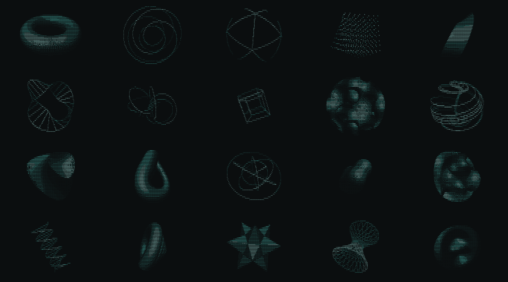
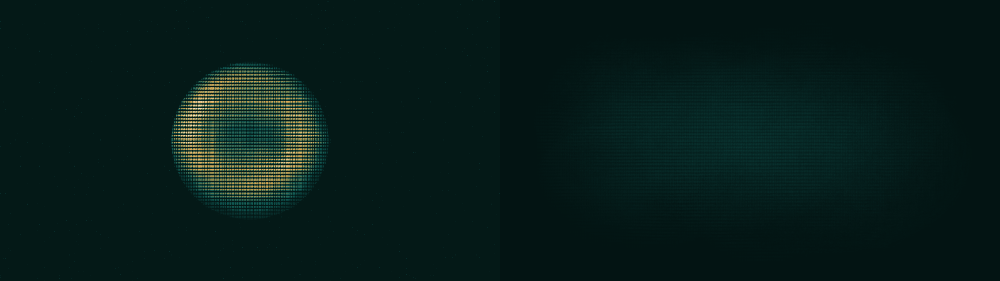

<p align="center"></p>

<h1 align="center">Glyphspin</h1>

<p align="center"><b>Mathematics, typeset. Alive on your desktop.</b><br>
A 3D object drawn entirely in text glyphs, drifting behind your icons as a live wallpaper for Windows and macOS.</p>

<p align="center">
  <a href="https://github.com/dexterlabs1/glyphspin/releases/latest"><b>Download for Windows</b></a> &nbsp;·&nbsp;
  <a href="https://github.com/dexterlabs1/glyphspin/releases/latest"><b>Download for macOS</b></a> &nbsp;·&nbsp;
  MIT licensed, free
</p>

https://github.com/user-attachments/assets/cbb960a7-2b7b-4364-8167-63d7c3d43662

<p align="center"><sub>A one-minute screen recording of a real desktop: drag to spin, click ripples, explode, the slicing plane, a morph and a 4D turn.</sub></p>

## Why it's different
- **Made of type.** Every frame is a grid of characters: a luminance ramp, braille or dots, shaded in five depth
  bands of one colour. No textures, no video loop: it is computed live.
- **20 objects worth staring at.** Torus knots, a Hopf fibration, a tesseract and 24-cell turning through the
  fourth dimension, a gyroid shell, Lorenz and Aizawa attractors that draw themselves, a Klein bottle, a
  Calabi-Yau slice, a crystal that grows into a star, a seashell, a double helix and more. Every reroll mixes a shape, a render mode (solid,
  wire or points), an ambient effect and a transition.
- **It roams.** The object travels the whole screen in slow straight lines and turns softly at the edges, like the
  old DVD logo at a fraction of the speed. Prefer calm? Switch to a gentle wander.
- **Hands on.** Middle-drag to spin it with inertia, scroll to zoom, click to send a ripple through the background
  glyphs, click and hold to explode it. Your icons, selection and right-click menu work exactly as before.
- **Hears your music.** It listens to Apple Music only, so game audio and notification pings never move it: bass
  breathes, beats ripple, loudness spins.
- **Eight themes.** Teal, amber, ice, sage, paper, ember, mono and rose, each crossfading into the next, on a
  schedule if you like. **OLED black** turns every pixel without a glyph fully off.
- **Kind to OLED.** Nothing lights the same pixels for hours. In a two-hour simulated burn-in the hottest pixel
  drops from 33 % of SDR white to 3 %, and bouncing across the screen halves it again.
- **HDR done properly.** Glyphs sit at or below your SDR white; only brief effects reach into HDR highlights
  (FP16 scRGB on Windows, EDR on XDR and HDR Macs).
- **Featherweight.** About 2-3 % of one CPU core while drifting and 25 MB of memory. Covered, locked or asleep, it
  stops completely.

<p align="center"></p>

## Install
**Windows 10 2004+ / Windows 11** (Direct3D 11 GPU)
1. Download `glyphspin-<version>-windows-x64.zip` from [Releases](../../releases/latest) and unzip it anywhere.
2. Run `glyphspin.exe`. A dotted ring appears in the system tray and the wallpaper takes over the desktop
   background.
3. **Quit** in the tray menu (or `glyphspin.exe --quit`) brings your normal wallpaper back.

No installer and no admin rights. Settings live in `%APPDATA%\Glyphspin\settings.json`; "Start with Windows" in the
tray menu is off until you turn it on.

**macOS 13 Ventura or later** (Apple silicon or Intel, one universal app)
1. Download `glyphspin-<version>-macos-universal.zip` from [Releases](../../releases/latest), unzip it and move
   `Glyphspin.app` to Applications.
2. The app isn't notarized, so allow the first launch: on macOS 13 / 14 right-click it and choose **Open**; on
   macOS 15+ open it once, then click **Open Anyway** in **System Settings > Privacy & Security**.
3. A dotted ring appears in the menu bar and the wallpaper fills the desktop behind your icons. Your own wallpaper
   is never changed: Glyphspin draws in its own window at desktop level.
4. Music reactivity needs macOS 14.2+ and asks once for **System Audio Recording** permission. Without it the
   wallpaper still works, just without the music.

Settings live in `~/Library/Application Support/Glyphspin/settings.json`; "Open at Login" is off until you turn it
on.

## Controls
| On the bare desktop | Does |
|---|---|
| Middle-drag (Mac: also Option + drag) | spin it; let go and it coasts, then eases back into its drift |
| Shift + middle-drag | turn a 4D shape through the fourth dimension |
| Scroll | zoom (Ctrl + scroll stays Explorer's icon size; Control + scroll stays the Mac's screen zoom) |
| Click | a ripple through the faint background glyphs |
| Click and hold, still | exploded view, closes when you let go |
| Middle double-click (Mac: also Option + double-click) | reroll to a new combination |

Glyphspin only observes the mouse; it never blocks or swallows input. On macOS it doesn't ask for Accessibility
access, so a click on a Finder icon ripples too.

## The menu
Reroll · **Shape** (random or any of the 20) · **Look** (glyph style, glyph size, motion: bounce or wander) ·
**Theme** (eight palettes, OLED black background, rotate themes: off, with each new shape, or every 15, 30 or 60
minutes) · **Effects** (off, subtle, full) · **Music** (Apple Music, all audio or off, plus intensity) · **Display**
(HDR auto / on / off, highlight strength) · **OLED care** · **Frame rate** (15 / 30 / 60 max) · Pause · Start with
Windows / Open at Login · Quit.

Everything is also in `settings.json`, including the reroll weights (`w_solid`, `w_wire`, `w_points`, `w_plain`,
`w_sweep`, `w_density`, `w_dissolve`, `w_morph`).

## OLED care
On by default, because a wallpaper is the most static thing a screen shows.
- The object travels the whole screen (bounce) or most of it (wander), and slowly breathes in size.
- The glyph grid orbits by up to 3/4 of a cell in whole pixels, so glyph edges never sit on the same pixels.
- Background dots fade in and out every few minutes, in new places.
- At rest the brightest glyph is about half your SDR white. Only brief effects reach HDR highlights, fading within
  1-3 s, and the average picture level is capped.
- After 10 idle minutes it dims to 30 %; after 30 more it fades to black and stops drawing. Any input brings it
  back.
- A new shape every 25 minutes, and an optional true-black background.

<p align="center"></p>
<p align="center"><sub>Two hours of light per pixel, same scale: without OLED care (left) and with it (right).</sub></p>

## Music
On Windows, Glyphspin captures only the Apple Music app's audio (per-process loopback; it finds the Apple Music
process that is actually playing, including the background agent current versions use). On macOS a Core Audio
process tap listens to the Music app. "All audio" listens to the whole output instead. Capture runs only while
something is playing and the wallpaper is visible, and it never affects playback.

## Performance
Measured at 3840x2160 (Ryzen 9 9950X3D, RTX 5090), release build:

| State | CPU (one core) |
|---|---|
| Desktop covered, locked or display off | 0.1 % (fully paused, no frames) |
| Drifting, 12 fps, depending on shape | 1.8 - 3.3 % |
| During effects (spin, explode, sweep, reroll) | about 6 % |
| Music reacting, 30 fps | about 9 % |

About 25 MB private working set; the GPU draws one fullscreen pass per frame.

## Build from source
```
git clone https://github.com/dexterlabs1/glyphspin
cd glyphspin
cargo build --release
target\release\glyphspin.exe
```
Windows needs Rust (stable, MSVC) and the Windows SDK (`rc.exe` embeds the icon). The compiled shaders
(`shaders/*.cso`) are committed, so `fxc` is only needed if you edit `shaders/glyph.hlsl`.

macOS needs Rust with the `aarch64-apple-darwin` and `x86_64-apple-darwin` targets, the Xcode command line tools
and python3:
```
packaging/macos/bundle.sh        # dist/Glyphspin.app (universal, ad-hoc signed) and its zip
open dist/Glyphspin.app
```

## How it works
- A shared, platform-free core rasterises the shape onto a grid of character cells (about 25,000 at 4K) and
  composes every effect there, on the CPU. One small texture goes to the GPU and a single pixel shader turns cells
  into glyphs.
- **Windows:** on 11 24H2+ the desktop is a `Progman` window holding the icon layer and a `WorkerW` that paints the
  static wallpaper. Glyphspin slots its own window between the two and draws with Direct3D 11 through
  DirectComposition (scRGB for HDR, sRGB otherwise).
- **macOS:** each screen gets a borderless window at desktop level, above the system wallpaper and below Finder's
  icons, drawn with Metal (sRGB, or extended-range float when the screen has EDR headroom).
- It sleeps on a high-resolution timer between frames, drops to 12 fps when nothing moves, and stops completely,
  mouse hook and audio included, whenever the desktop isn't visible.

## License
MIT. See [LICENSE](LICENSE).
