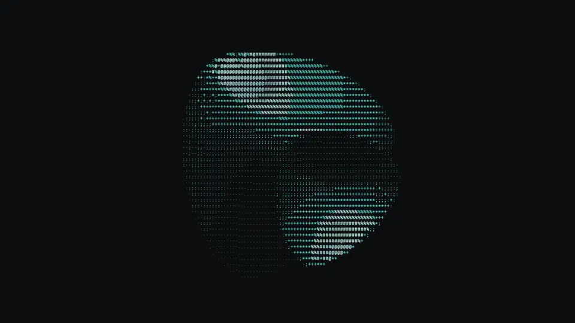
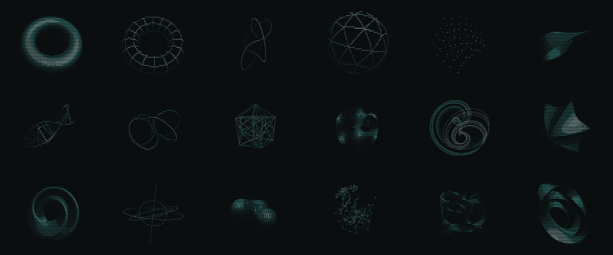
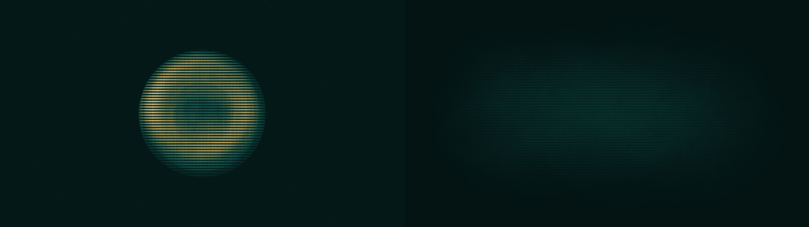

<p align="center"></p>

<h1 align="center">Glyphspin</h1>

<p align="center">A 3D object drawn in text, turning slowly as your live Windows wallpaper.</p>

<p align="center"></p>
<p align="center"><sub>Frames read back from the app's own swapchain at 3840x2160 (cropped).</sub></p>
<p align="center"><a href="https://github.com/dexterlabs1/glyphspin/releases/download/v0.1.0/glyphspin-demo.mp4"><b>Watch the one-minute demo</b></a> (a screen recording of a real desktop: drag, ripples, explode, slicing plane, morph, 4D turn)</p>

## Features
- **18 mathematical objects**, rendered as a luminance ramp, braille or dot glyphs in Cascadia Mono: torus, knots,
  geodesic sphere, Hopf fibration, a tesseract / 24-cell rotating in 4D, gyroid shell, Lorenz and Aizawa
  attractors that draw themselves, morphing supershapes, a Klein bottle, armillary rings, metaballs, a nebula with
  constellation lines, a Calabi-Yau slice and more.
- **Lives behind your desktop icons.** Icons, selection, double-click and the right-click menu all work as before.
- **Hands on.** Middle-drag to spin it with inertia, scroll to zoom, click for a ripple, click and hold to explode
  it, shift + middle-drag to turn 4D shapes through the fourth dimension.
- **Always fresh.** Every reroll picks a shape, a render mode (solid / wire / points), an ambient effect (a slicing
  plane, depth through glyph density) and a transition (dissolve or morph).
- **HDR aware.** FP16 scRGB on HDR displays, glyphs at or below your SDR white, highlights only in brief effects.
- **OLED care**, on by default: nothing lights the same pixels for hours (see below).
- **Music reactive** with Apple Music (or any audio), capturing only that app's sound.
- **Light.** About 2-3 % of one CPU core while drifting, nothing at all when the desktop is covered.

<p align="center"></p>

## Requirements
- Windows 10 2004+ or Windows 11 (tested on Windows 11 24H2 / 25H2, where the desktop's window layout changed;
  older layouts are handled by the classic WorkerW path).
- A GPU with Direct3D 11.
- HDR is optional. Apple Music (Microsoft Store version) is optional.

## Install
1. Download `glyphspin-<version>-windows-x64.zip` from [Releases](../../releases) and unzip it anywhere.
2. Run `glyphspin.exe`. A small dotted ring appears in the system tray; the wallpaper takes over the desktop
   background.
3. To stop it, choose **Quit** in the tray menu (or run `glyphspin.exe --quit`). Your normal wallpaper comes back.

Nothing is installed; settings live in `%APPDATA%\Glyphspin\settings.json`. "Start with Windows" in the tray menu
adds or removes a `HKCU\...\Run` entry; it is off unless you turn it on.

## Controls
| On the bare desktop | Does |
|---|---|
| Middle-drag | rotate; let go and it coasts, then eases back into its drift |
| Shift + middle-drag | turn a 4D shape through the xw / yw planes |
| Scroll | zoom (Ctrl + scroll stays Explorer's icon size) |
| Click | a ripple through the faint background glyphs |
| Click and hold (still) | exploded view, closes when you let go |
| Middle double-click | reroll to a new combination |

The app only observes the mouse; it never blocks or swallows input.

## Tray menu and settings
Reroll · Shape (random or any of the 18) · Look (style, glyph size, colour: teal / amber / ice / sage / paper) ·
Effects (off / subtle / full) · Music (Apple Music / all audio / off, intensity) · Display (HDR auto / on / off,
highlight 0-100 %) · OLED care · Frame rate (15 / 30 / 60 max) · Pause · Start with Windows · Quit.

`settings.json` also holds the reroll weights: `w_solid`, `w_wire`, `w_points` (render modes), `w_plain`,
`w_sweep`, `w_density` (ambient effect) and `w_dissolve`, `w_morph` (transition).

## OLED care
On by default, because a wallpaper is the most static thing a screen shows.
- The object wanders slowly over most of the screen and gently changes size (periods of 5-15 minutes, eased).
- The glyph grid orbits by up to 3/4 of a cell in whole pixels, so glyph edges never sit on the same pixels.
- Background dots fade in and out every few minutes, in new places.
- At rest the brightest glyph is about half your SDR white (about 120 nits at a 240-nit SDR white). Only brief
  effects reach HDR highlights, and they fade within 1-3 s. The average picture level is capped.
- After 10 minutes without input it dims to 30 %; after 30 more minutes it fades to black and stops drawing. Any
  input brings it back.
- A new shape every 25 minutes.

A two-hour simulated burn-in (per-pixel light summed over the run, same scale) shows the difference: the hottest
pixel drops from 33 % of SDR white on average to 3 %, and its ratio to the screen mean from 37x to 5x.

<p align="center"></p>

## Music
With the Apple Music app playing, Glyphspin captures that app's audio only (Windows per-process loopback), so game
sounds and notification pings don't move it; "all audio" listens to the default output instead. Bass breathes the
object's size, beats send soft flashes or ripples, mids and highs speed its slow morph, loudness speeds the spin,
and eight spectrum bands ripple the surface. Capture runs only while something is playing (via the Windows media
session) and the wallpaper is visible. It is read-only and doesn't affect playback.

## Performance
Measured on a 3840x2160 desktop (Ryzen 9 9950X3D, RTX 5090), release build:

| State | CPU (one core) |
|---|---|
| Desktop covered, locked or display off | 0.1 % (fully paused, no frames) |
| Idle drift, 12 fps, depending on shape | 1.8 - 3.3 % |
| During effects (spin, explode, sweep, reroll) | about 6 % |
| Music reacting, 30 fps | about 9 % |

Memory: about 25 MB private working set. GPU load is a single fullscreen pass per frame.

## Build from source
```
git clone https://github.com/dexterlabs1/glyphspin
cd glyphspin
cargo build --release
target\release\glyphspin.exe
```
Needs Rust (stable, MSVC toolchain) and the Windows SDK (for `rc.exe`, which embeds the icon). The compiled
shaders (`shaders/*.cso`) are committed, so `fxc` is only needed if you edit `shaders/glyph.hlsl`.
`python tools/brand.py` regenerates the icon and logo.

## How it works
- On Windows 11 24H2+ the desktop is a `Progman` window whose children are the icon layer (`SHELLDLL_DefView`) and
  a `WorkerW` painting the static wallpaper. Glyphspin parents its own window between the two and draws into it
  with Direct3D 11 through DirectComposition.
- Each frame, the CPU rasterises the shape onto a grid of character cells (about 25,000 at 4K) and composes the
  effects there; one small texture is uploaded and a single pixel shader turns cells into glyphs from a Cascadia
  Mono atlas, in scRGB for HDR or sRGB otherwise.
- It sleeps between frames on a high-resolution timer, drops to 12 fps when nothing is moving, and stops
  completely (including its mouse hook and audio capture) whenever the desktop isn't visible.

## License
MIT. See [LICENSE](LICENSE).
